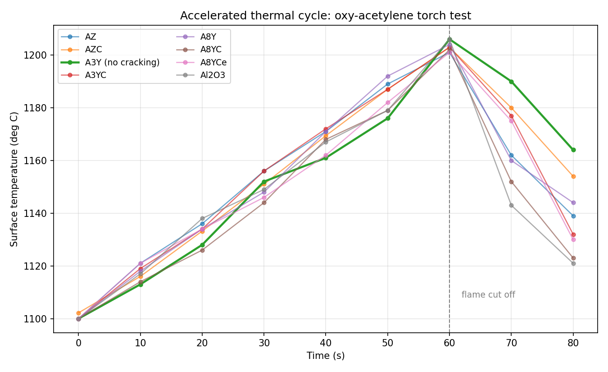
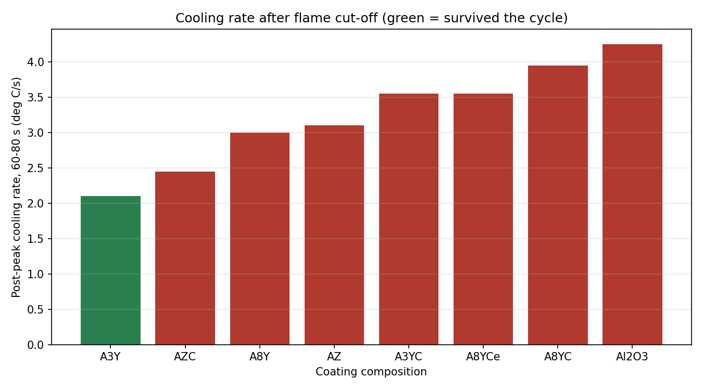

# Residual Life Assessment of Alumina-Based Thermal Barrier Ceramic Coatings

Accelerated thermal-cycle testing of eight alumina-based thermal barrier coating (TBC)
compositions, to establish which survive ultra-high-temperature service and why.



## Problem

Thermal barrier coatings let gas-turbine components run hotter than their superalloy
substrates could otherwise tolerate. Alumina is attractive for this — high hardness,
corrosion resistance, not oxygen-transparent — but it is brittle. Under repeated heating
and quenching, the thermal expansion mismatch between substrate, bond coat and top coat
generates residual stress; cracks initiate, propagate, and the coating spalls.

Two standard remedies are tested here:

- **Yttria-stabilised zirconia (YSZ)** added for mechanical stability and a coefficient
  of thermal expansion closer to the substrate
- **Carbon nanotubes (CNTs)** added to obstruct crack propagation

The question: across these compositions, which survives a thermal cycle to >1100 °C, and
does the measured thermal response explain the result?

## Samples

Eight plasma-sprayed (APS) compositions, deposited at IIT Patna
(708 A, 57.2 V, 35-40 kW, argon 80-100 scfh, hydrogen 12-15 scfh, feed rate 12-15 g/min,
stand-off 80-100 mm).

| Sample | Composition | CNT | Survived cycle |
|---|---|---|---|
| **A3Y** | µ-Al₂O₃ + n-Al₂O₃ + 20 wt% 3YSZ | no | **yes** |
| AZ | µ-Al₂O₃ + n-Al₂O₃ + 20 wt% ZrO₂ | no | no |
| AZC | µ-Al₂O₃ + n-Al₂O₃ + 20 wt% ZrO₂ + 4 wt% CNT | yes | no |
| A3YC | µ-Al₂O₃ + n-Al₂O₃ + 20 wt% 3YSZ + 4 wt% CNT | yes | no |
| A8Y | µ-Al₂O₃ + n-Al₂O₃ + 20 wt% 8YSZ | no | no |
| A8YC | µ-Al₂O₃ + n-Al₂O₃ + 20 wt% 8YSZ + 4 wt% CNT | yes | no |
| A8YCe | µ-Al₂O₃ + n-Al₂O₃ + 20 wt% 8YSZ + 20 wt% CeO₂ | no | no |
| Al₂O₃ | micro-alumina baseline | no | no |

## Method

A purpose-built oxy-acetylene torch rig was used for the thermal shock test:

1. Each sample is fixed in a groove of a graphite block, 2 inches from the torch
2. A graphite slice shields the sample while the flame stabilises, so the coating is not
   exposed to the low-temperature ramp
3. The shield is removed at 1100 °C and the flame strikes the coating directly
4. Once the coating reaches 1100 °C it is heated a further 60 s
5. The flame is cut off and the sample cools naturally
6. Surface temperature is logged throughout with a non-contact infrared pyrometer at a
   fixed stand-off

Surfaces and cross-sections were then imaged before and after testing on a trinocular
optical microscope (Weswox Optik SZM-180) at 120×, and crack extent quantified in
**ImageJ**.

## Results

**Only A3Y survived the cycle without cracking.** Every other composition — including the
plain alumina baseline and every CNT-modified variant — cracked severely under the
thermal shock, making them unsuitable for service above 1100 °C.

Cross-sectional imaging showed cracks propagating into the bulk rather than staying at
the surface. Cracks initiated at the centre of each sample, where the flame was focused,
and ran outwards to the points held by the graphite grooves — consistent with restrained
thermal expansion generating the stress.

### Cooling rate tracks survival



Analysing the measured profiles after flame cut-off (60 → 80 s) gives a clear ordering:

| Sample | Peak (°C) | At 80 s (°C) | Drop (°C) | Cooling rate (°C/s) | Survived |
|---|---|---|---|---|---|
| **A3Y** | 1206 | 1164 | 42.0 | **2.10** | **yes** |
| AZC | 1202.9 | 1154 | 48.9 | 2.45 | no |
| A8Y | 1204 | 1144 | 60.0 | 3.00 | no |
| AZ | 1201 | 1139 | 62.0 | 3.10 | no |
| A3YC | 1203 | 1132 | 71.0 | 3.55 | no |
| A8YCe | 1201 | 1130 | 71.0 | 3.55 | no |
| A8YC | 1202 | 1123 | 79.0 | 3.95 | no |
| Al₂O₃ | 1206 | 1121 | 85.0 | 4.25 | no |

The surviving composition cooled the slowest — **2.10 °C/s against 4.25 °C/s for the
plain alumina baseline**, roughly half the rate. Since the driving force for cracking is
the transient thermal gradient, a coating that sheds heat more slowly develops a smaller
gradient and therefore lower transient stress. The ranking is consistent with that
mechanism: the two slowest-cooling samples are the least damaged, the fastest-cooling
baseline is among the worst.

This is a correlation across eight samples in a single cycle, not a proof of mechanism —
but it is a testable one, and it points at thermal diffusivity as the property worth
measuring next.

### Note on the CNT additions

CNTs did not rescue any composition here. Comparing each pair (AZ/AZC, A3Y/A3YC,
A8Y/A8YC), the CNT-modified variant cooled *faster* and cracked in every case — most
strikingly A3YC, where adding CNTs to the one surviving composition caused it to fail.
The likely explanation is the high thermal conductivity of CNTs raising the coating's
effective conductivity, steepening the transient gradient. Worth confirming with
conductivity measurements before drawing a firm conclusion.

## Repository layout

```
data/     digitised temperature-time profiles, compositions, derived summary
src/      analysis script (regenerates every figure)
figures/  generated plots
docs/     full project report
```

## Running it

```bash
pip install -r requirements.txt
python src/analyse_thermal_cycles.py
```

Every number in the results tables is recomputed from `data/`; nothing is hard-coded.

## Data provenance

`data/thermal_cycle_profiles.csv` contains the pyrometer readings recorded during
testing, digitised from the temperature-profile plots in the project report
(`docs/`). The compositions and survival outcomes come from the same report.

## Next steps identified

Scanning electron microscopy of the tested samples, to resolve crack morphology and
the thermally grown oxide layer at the bond-coat interface.

## Team and attribution

B.Tech major project, Department of Mechanical Engineering, Rajkiya Engineering College
Banda (Dr. A.P.J. Abdul Kalam Technical University, Lucknow), May 2022.

Project team: Ram Prasad, **Shakti Kumar**, Suraj Kumar, Jitendra Kumar Chaurasiya,
Prince Kumar.

Supervisors: Mr. Saurabh Tripathi and Dr. Ashutosh Tiwari. Plasma spray deposition was
carried out at IIT Patna.

*My contribution: <describe your role here — e.g. experimental rig assembly, thermal
cycle testing, pyrometer data acquisition, optical microscopy, ImageJ crack analysis>.*
The data analysis and figures in this repository are my own work.
